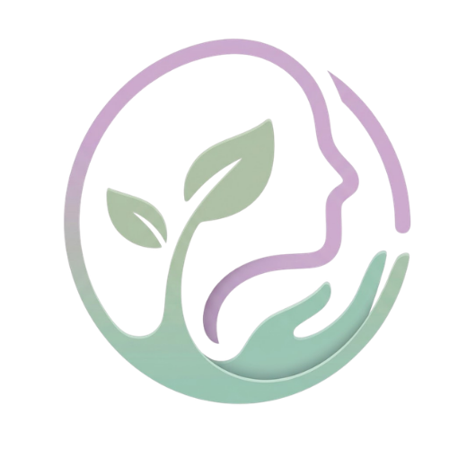

<p align="center">
  
</p>

# Calmind - Saúde Mental & Acolhimento

**Trabalho de Conclusão de Curso · Técnico em Desenvolvimento de Sistemas · SENAI-SP · 4º termo · 2026**

Aplicativo mobile que atua no intervalo entre uma sessão de terapia e a seguinte.

> **Nome e slogan fechados:** Calmind, com o slogan **Saúde Mental & Acolhimento**. Vale para o aplicativo, a landing page, a capa do documento final e os slides. A identidade completa, incluindo propósito, público-alvo, logotipo, paleta e tipografia, está em [`docs/identidade-visual.md`](docs/identidade-visual.md). O identificador do pacote do aplicativo segue em aberto no formato `com.<grupo>.calmind`. Ver `docs/planejamento/arranque-react-native.md`.

---

## O problema

Pesquisa de campo com três entrevistadas sem relação entre si, duas psicólogas e uma paciente. As dores relatadas convergiram de forma independente:

- comunicação fragmentada entre as sessões;
- agendamento manual, sujeito a esquecimento;
- baixa adesão às tarefas prescritas;
- tempo de sessão gasto em recapitulação em vez de trabalho clínico;
- ausência de ferramentas de apoio para os dois lados.

**A hipótese central:** a qualidade do tratamento depende tanto do que acontece na sessão quanto do que acontece entre as sessões, e é justamente esse intervalo que não tem ferramenta nenhuma. O produto ataca o intervalo, não a sessão.

## Produto proposto e MVP da Sprint 2

O produto completo prevê relatos, tarefas, chat, agenda, lembretes de medicação e resumos por IA. Esses recursos compõem a proposta e não descrevem o estado integral da Sprint 2.

O MVP atual reúne API Laravel e MySQL, painel Blade e aplicativo React Native com Expo. A API implementa os blocos **A, C, D, E e F**: autenticação; cadastro e aprovação de psicólogos; catálogo, convite e vínculo; relatos com restrição de privacidade; e tarefas. O painel permite administrar cadastros e acompanhar tarefas. O aplicativo apresenta entrada com tratamento de erro, escolha de perfil, cadastro do paciente, catálogo de psicólogos e tarefas do paciente. O bloco **B**, referente ao fluxo completo de consentimento, ainda não foi entregue; a demonstração usa aceite fictício preparado no banco. Chat, agenda, medicação, IA e prontuário consolidado permanecem fora do MVP.

Os dados compartilhados entre web e app foram demonstrados em 23/10/2026: o psicólogo aprovado no painel web aparece no catálogo do aplicativo. O ciclo de tarefas (criada na web, concluída pela API como paciente, exibida como concluída na web) foi demonstrado em 22/10/2026. Nada foi testado em celular físico, iOS ou Android; o app foi verificado no Expo web. Ver [roteiro da I2](docs/testes/2026-10-23-roteiro-i2.md) e [evidências](docs/testes/README.md).

### Executar o MVP

O preparo do MySQL, a configuração do `.env` e os dados fictícios estão descritos em [backend/README.md](backend/README.md) e no [setup do backend](docs/engenharia/setup-backend.md). Com PHP e Composer instalados, dentro de `backend/`:

```bash
composer install
cp .env.example .env
php artisan key:generate
php artisan migrate --seed
php artisan serve
```

Configure a conexão MySQL no `.env` antes da migração. Em outra janela, dentro de `app/`, siga [app/README.md](app/README.md) e execute:

```bash
npm ci
cp .env.example .env
npx expo start
```

No `.env` do aplicativo, ajuste `EXPO_PUBLIC_API_URL` para o endereço do servidor acessível pelo dispositivo ou navegador e use `EXPO_PUBLIC_USE_MOCK=false` para acessar dados reais. A URL `localhost` do computador não funciona como endereço da API em um telefone. Para verificar o código, use `php artisan test` em `backend/` e `npm test`, `npm run lint` e `npx tsc --noEmit` em `app/`. Em 23/10/2026, a suíte do backend passou com 197 testes e 3.556 asserções, o Newman passou nas pastas A, C, D, E e F com 55 requisições e 105 asserções, e o aplicativo passou 66 testes, lint e TypeScript. As saídas estão em [docs/testes](docs/testes/README.md).

## Os quatro compromissos que o produto não quebra

Estes compromissos definem o produto planejado. Na Sprint 2, a privacidade dos relatos foi testada; os recursos de IA e medicação ainda não foram implementados.

1. **A IA, quando implementada, dependerá de ação do profissional.** O requisito prevê revisão humana antes de qualquer registro.
2. **Relatos privados devem permanecer restritos ao paciente.** A garantia está na camada de dados (view `shared_reports`) e é comprovada pelo `ReportPrivacyTest` e pela pasta E do Newman.
3. **A plataforma não prescreverá medicação.** Essa é uma regra de produto prevista nos requisitos.
4. **A escolha de tratamento não terá ranking comercial.** Essa é uma regra de produto prevista nos requisitos.

---

## Entrega da Sprint 1

**Os quatro entregáveis pedidos, e o link direto de cada um.** Esta é a tabela para quem vem
avaliar a Sprint 1; a tabela seguinte é a do plano completo das três sprints.

| # | Entregável | Onde | Estado |
|---|------------|------|--------|
| **1** | **Identidade da marca e branding**<br>nome, propósito, público-alvo, logotipo, paleta e tipografia | [`docs/identidade-visual.md`](docs/identidade-visual.md)<br>logo em [`docs/prototipo/assets/`](docs/prototipo/assets/)<br>propósito e operação em [`docs/modelo-de-negocio-calmind.md`](docs/modelo-de-negocio-calmind.md) | Pronto. Logo em 5 variantes PNG; SVG pendente |
| **2** | **Documento de requisitos**<br>RF, RNF e RN | [`docs/documento-requisitos.md`](docs/documento-requisitos.md) | Pronto. **49 RF**, **68 RNF** e **52 RN**, com critérios de aceitação e prioridade MoSCoW |
| **3** | **Diagramas de modelagem**<br>MER e DER | MER: [`docs/diagramas/modelo-de-dados.md`](docs/diagramas/modelo-de-dados.md#2-mer-modelo-entidade-relacionamento)<br>DER: [`docs/diagramas/der.md`](docs/diagramas/der.md)<br>DDL executável: [`docs/diagramas/schema.sql`](docs/diagramas/schema.sql) | Pronto. 25 entidades. O DER foi executado e testado, não só desenhado |
| **4** | **Wireframes e mockups**<br>principais telas e o fluxo entre elas | [`docs/prototipo/wireframes.html`](docs/prototipo/wireframes.html)<br>[`docs/prototipo/fluxo-ux.html`](docs/prototipo/fluxo-ux.html)<br>[`docs/prototipo/telas-pdf/`](docs/prototipo/telas-pdf/) | Pronto. 16 telas em wireframe, 21 telas exportadas do Figma em PDF, mapa de UX navegável |

Como material de apoio da coleta de requisitos, que sustenta os quatro itens acima:
[`docs/pesquisa/`](docs/pesquisa/) traz o roteiro das entrevistas, a ferramenta de aplicação e as
**2 sínteses anonimizadas** já realizadas; [`docs/documento-base-sprint1.md`](docs/documento-base-sprint1.md)
consolida o problema, a visão e as 18 decisões de produto com as respectivas justificativas.

---

## Entregáveis da regulamentação e onde estão

| Exigência | Sprint | Onde | Estado |
|-----------|--------|------|--------|
| Identidade da marca e branding | 1 | [`docs/identidade-visual.md`](docs/identidade-visual.md) | Pronto |
| Requisitos funcionais, não funcionais e regras de negócio | 1 | [`docs/documento-requisitos.md`](docs/documento-requisitos.md) | Pronto, 49 RF, 68 RNF e 52 RN |
| Diagramas de modelagem (MER, DER e outros) | 1 | [`docs/diagramas/`](docs/diagramas/) | Pronto |
| Prototipação da interface | 1 | [`docs/prototipo/`](docs/prototipo/) | Pronto, 16 telas |
| Coleta e análise dos requisitos | 1 | [`docs/pesquisa/`](docs/pesquisa/) | Roteiro e formulário prontos, 2 das 4 entrevistas aplicadas e sintetizadas |
| Backend e frontend, primeiras funcionalidades | 2 | [`backend/`](backend/), [`app/`](app/) e [`docs/planejamento/etapas-sprint2.md`](docs/planejamento/etapas-sprint2.md) | MVP dos blocos A, C, D, E e F implementado; fluxo de consentimento B pendente |
| Primeiros testes | 2 | [`docs/testes/`](docs/testes/) | Suíte integrada e roteiro web/API registrados em 22/10/2026 |
| Sistema completo | 3 | ainda não iniciado | Pendente |
| Documentação técnica final em ABNT | 3 | [`docs/documento-final/CALMIND_ABNT.docx`](docs/documento-final/CALMIND_ABNT.docx) | Versionado e atualizado com o MVP da Sprint 2; revisão final na Sprint 3 |
| Manual do usuário | 3 | ainda não iniciado | Pendente |
| Relatório de testes | 3 | [`docs/testes/`](docs/testes/) | Primeiras evidências registradas; consolidação final na Sprint 3 |

## Como abrir cada artefato

**Identidade visual.** [`docs/identidade-visual.md`](docs/identidade-visual.md) renderiza direto no GitHub, com o logotipo, os códigos hexadecimais da paleta e a escala tipográfica. O histórico de por que cada decisão de design foi tomada, e quando mudou, está em [`CONTEXTO.md`](CONTEXTO.md).

**Wireframes.** Abra `docs/prototipo/wireframes.html` em qualquer navegador para ver as 16 telas em uma página. O mapa de UX em `docs/prototipo/fluxo-ux.html` mostra como elas se conectam e exporta em PNG e PDF. As telas montadas no Figma estão em `docs/prototipo/telas-pdf/`. Os protótipos representam o produto planejado e não comprovam que cada tela foi implementada no MVP.

**Modelo de dados.** O MER e os diagramas de estado estão em `docs/diagramas/modelo-de-dados.md`, e o DER com atributos, chaves e tipos está em `docs/diagramas/der.md`. Os dois renderizam direto nesta página do GitHub. O DER também é executável:

```bash
mysql -u root -e "CREATE DATABASE tcc_schema_test"
mysql -u root tcc_schema_test < docs/diagramas/schema.sql
mysql -u root --force --table tcc_schema_test < docs/diagramas/testes-do-modelo.sql
```

As quatro provas verificam que o banco, e não o código da aplicação, garante o vínculo ativo único por paciente e o isolamento do relato privado.

**Entrevistas.** O roteiro das 4 entrevistas de campo está em [`docs/pesquisa/roteiro-entrevistas.md`](docs/pesquisa/roteiro-entrevistas.md), e as 2 já aplicadas estão sintetizadas em [`sintese-P1`](docs/pesquisa/sintese-P1-paciente-em-acompanhamento.md) e [`sintese-P2`](docs/pesquisa/sintese-P2-paciente-que-interrompeu.md). Para aplicar as próximas, abra [`docs/pesquisa/formulario.html`](docs/pesquisa/formulario.html) no navegador: ele guarda as respostas na própria máquina, sobrevive a recarregar a página no meio da conversa e exporta a síntese anonimizada pronta em Markdown. Não precisa de servidor nem de internet.

As sínteses são anonimizadas por regra do projeto: nenhum nome, contato ou identificador aparece nelas, e o áudio das entrevistas nunca entra no repositório.

**Contrato da API.** Importe `docs/api/Calmind.postman_collection.json` no Postman e rode pelo Runner. A coleção cobre os blocos disponíveis e serve como critério de teste. Consulte `docs/testes/` para distinguir execuções datadas de requisições apenas preparadas.

---

## Tecnologias e execução

| Camada | Tecnologia |
|--------|------------|
| Aplicativo | React Native com Expo |
| Backend | Laravel, PHP |
| Banco de dados | MySQL |
| Painel do administrador | Blade e Bootstrap, sobre o mesmo backend |
| Divulgação | Landing page |

### Executar o aplicativo móvel

Requisitos: Node.js 24 e npm 11. No PowerShell, a partir da raiz do repositório:

```powershell
Set-Location .\app
npm install
if (-not (Test-Path .env)) { Copy-Item .env.example .env }
```

Confirme que EXPO_PUBLIC_USE_MOCK=true está definido em app/.env para usar as contas e os dados simulados. Depois inicie o Expo:

```powershell
npm start
```

O cliente HTTP exige EXPO_PUBLIC_API_URL e um servidor compatível. Sem back-end, mantenha o modo mock. O comando configurado para os testes do aplicativo é npm test; esta atualização não executou testes nem gerou logs.

### Executar o back-end

O back-end **não pode ser iniciado neste checkout**, porque a pasta backend/ ainda não contém o projeto Laravel. O roteiro previsto está em docs/engenharia/setup-backend.md; comandos de migração e artisan só serão aplicáveis quando os arquivos do servidor forem incorporados.

## Equipe

| Pessoa | Papel |
|--------|-------|
| Rafael Brecci | Product Owner e desenvolvimento backend |
| Caio Yuri | Scrum Master e desenvolvimento do aplicativo |
| Eduardo Zanetti | Desenvolvimento backend |
| Mariana Chaves | Desenvolvimento, apoio às duas frentes |
| Nicoly Ribeiro | Documentação e apresentação |
| Isabela Puzenato | Documentação e apresentação |

## Estrutura do repositório

```
CONTRIBUTING.md   como commitar e abrir PR neste repositório; leia antes do primeiro commit
CONTEXTO.md       diário das decisões de design: o que mudou, quando e por quê
backend/       documentação da arquitetura prevista; aplicação Laravel ainda ausente
app/           Expo + React Native: base móvel com navegação e autenticação mock
landing/       página de divulgação
docs/
├── identidade-visual.md         marca: propósito, público, logo, paleta e tipografia
├── modelo-de-negocio-calmind.md modelo de negócio e operação da marca
├── documento-base-sprint1.md    visão do produto e as 18 decisões de produto
├── documento-requisitos.md      49 RF, 68 RNF e 52 RN, priorizados por MoSCoW
├── pesquisa/                    roteiro das entrevistas, formulário de aplicação e sínteses
├── diagramas/                   MER, DER, DDL executável e provas do modelo
├── prototipo/                   wireframes, mapa de UX, telas em PDF, logo e scripts do Figma
├── api/                         contrato e coleção de testes do Postman
├── engenharia/                  setup, arquitetura, convenções e divisão de trabalho
├── planejamento/                cronograma, etapas da sprint, arranque do RN e decisões abertas
├── manual/                      manual do usuário          · Sprint 3
├── testes/                      evidências da Sprint 2 e relatório final na Sprint 3
├── documento-final/             documento ABNT, revisão final na Sprint 3
└── apresentacao/                slides e ensaios           · Sprint 3
```

As pastas de código estão em uso na Sprint 2. O documento ABNT e as evidências de teste da Sprint 2 estão versionados; a revisão final deles pertence à Sprint 3.

**Antes do seu primeiro commit, leia [`CONTRIBUTING.md`](CONTRIBUTING.md).** Ele traz o modelo de mensagem de commit, o passo a passo do branch ao merge e o que é um Pull Request, para quem nunca abriu um. Nada entra no `main` sem passar por PR.

**Não existe pasta `painel/`, e isso é de propósito.** O painel do administrador são views Blade dentro de `backend/`, sobre o mesmo Laravel, o mesmo banco e os mesmos Models. Separá-lo em projeto próprio significaria duplicar regra de negócio, que é o que o RNF-57 proíbe.

## Cronograma

| Sprint | Período | Foco |
|--------|---------|------|
| 1 | entrega em **24/09/2026, 16:45** | Identidade da marca, requisitos, modelagem e protótipo |
| 2 | entrega em **23/10/2026** | Backend, aplicativo e primeiros testes |
| 3 | a recalcular, com apresentação entre meados de novembro e começo de dezembro | Sistema completo, testes, documentação final e apresentação |

> As datas das Sprints 2 e 3 em `docs/planejamento/cronograma.md` foram montadas a partir de uma
> entrega da Sprint 1 em 21/08, que não se confirmou. Com a data real agora conhecida, aquele
> calendário precisa ser recalculado inteiro, não remendado.

Detalhamento semana a semana em `docs/planejamento/cronograma.md`.

---

## Sobre os dados

Este é um projeto acadêmico e **opera exclusivamente com dados fictícios**. Nenhum dado de paciente real é coletado, armazenado ou processado em qualquer ambiente do projeto.

O modelo proposto não conta com psicólogo Responsável Técnico registrado no conselho regional, limitação declarada abertamente na seção de limitações conhecidas do documento de requisitos. Em uso real, seria pré-requisito de operação.
