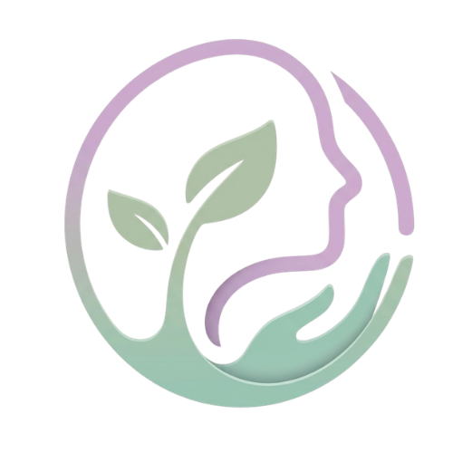

<p align="center">
  
</p>

# Calmind - Saúde Mental & Acolhimento

**Trabalho de Conclusão de Curso · Técnico em Desenvolvimento de Sistemas · SENAI-SP · 4º termo · 2026**

Aplicativo mobile que atua no intervalo entre uma sessão de terapia e a seguinte.

## O problema

Pesquisa de campo com três entrevistadas sem relação entre si, duas psicólogas e uma paciente. As dores convergiram de forma independente: comunicação fragmentada entre as sessões, agendamento manual sujeito a esquecimento, baixa adesão às tarefas, tempo de sessão gasto em recapitulação e ausência de ferramentas de apoio para os dois lados.

**Hipótese central:** a qualidade do tratamento depende tanto do que acontece na sessão quanto do que acontece entre as sessões, e é esse intervalo que não tem ferramenta. O produto ataca o intervalo, não a sessão.

## Estado atual

API Laravel e MySQL, painel web em Blade (administrador e psicólogo) e app React Native com Expo (paciente e psicólogo).

- **No app:** cadastro, aprovação de psicólogo, consentimento, catálogo, convite e vínculo, relatos com opção privada, calendário com o humor do dia, tarefas, chat, agenda, notificações dentro do app, perfil com foto e banner e tela de conta.
- **Só na API, ainda sem tela:** medicação, consentimento de IA, análise por IA e prontuário consolidado. A auditoria de leitura não tem tela.
- **Publicação:** API em `https://calmind-api.vercel.app` ([como funciona](docs/engenharia/hospedagem-alwaysdata.md)).

Detalhes, pendências e calendário: [`FinalSprint3.md`](docs/planejamento/FinalSprint3.md). O que fazer quando o desenvolvimento terminar: [`AO-FINALIZAR.md`](AO-FINALIZAR.md).

## Os quatro compromissos que o produto não quebra

1. **A IA só age quando o psicólogo pede**, e nada vai ao prontuário sem a confirmação dele.
2. **Relato privado fica restrito ao paciente.** A garantia está na camada de dados (view `shared_reports`), comprovada pelo `ReportPrivacyTest`.
3. **A plataforma não prescreve medicação**, apenas registra o que um médico prescreveu.
4. **A escolha do profissional não tem preço, nota nem ranking.**

## Como executar

| Quero | Guia |
|---|---|
| Rodar a API | [setup do backend](docs/engenharia/setup-backend.md) |
| Rodar o app | [setup do frontend](docs/engenharia/setup-frontend.md) (com `EXPO_PUBLIC_USE_MOCK=true` não precisa de backend) |
| Subir tudo numa máquina e gerar o APK | [rodar em outra máquina](docs/engenharia/rodar-em-outra-maquina.md) |
| Testar a API no Postman | importar [`Calmind.postman_collection.json`](docs/api/Calmind.postman_collection.json) e rodar pelo Runner; [contrato](docs/api/contrato-api.md) |
| Ver o modelo de dados | [MER](docs/diagramas/modelo-de-dados.md), [DER](docs/diagramas/der.md) e [`schema.sql`](docs/diagramas/schema.sql) |
| Provar o modelo no banco | [instruções](docs/diagramas/modelo-de-dados.md#6-verificação-o-modelo-foi-executado-não-só-desenhado) |
| Aplicar uma entrevista | abrir [`formulario.html`](docs/pesquisa/formulario.html) no navegador ([roteiro](docs/pesquisa/roteiro-entrevistas.md)) |
| Ver a landing page | abrir [`landing/index.html`](landing/index.html) |

## Entregáveis

| Exigência | Sprint | Onde | Estado |
|-----------|--------|------|--------|
| Identidade da marca e branding | 1 | [identidade visual](docs/identidade-visual.md) e [modelo de negócio](docs/modelo-de-negocio-calmind.md) | Pronto; logo em SVG pendente |
| Requisitos (49 RF, 68 RNF, 52 RN) | 1 | [documento de requisitos](docs/documento-requisitos.md) | Pronto |
| Diagramas de modelagem | 1 | [`docs/diagramas/`](docs/diagramas/) | MER, DER e estados prontos |
| Wireframes e protótipo | 1 | [`docs/prototipo/`](docs/prototipo/): 16 [wireframes](docs/prototipo/wireframes.html), [mapa de UX](docs/prototipo/fluxo-ux.html), [PDFs](docs/prototipo/telas-pdf/) e o [protótipo de 25/11](docs/prototipo/telas-25-11/) | Pronto |
| Coleta e análise dos requisitos | 1 | [`docs/pesquisa/`](docs/pesquisa/) e [documento base](docs/documento-base-sprint1.md) | 2 sínteses de pacientes no repositório; as das psicólogas não estão versionadas |
| Backend, frontend e primeiros testes | 2 | [`Sprint2.md`](docs/planejamento/Sprint2.md) | Entregue em 23/10 |
| Sistema completo | 3 | [`backend/`](backend/) e [`app/`](app/) | Em fechamento |
| Documentação técnica em ABNT | 3 | [`CALMIND_ABNT.docx`](docs/documento-final/CALMIND_ABNT.docx) | Falta atualizar (parado em 23/10) |
| Manual do usuário | 3 | [`docs/manual/`](docs/manual/) | Pendente |
| Relatório de testes | 3 | [`docs/testes/`](docs/testes/README.md) | Falta consolidar |
| Apresentação | 3 | [`docs/apresentacao/`](docs/apresentacao/) | Pendente; 04/12/2026 |

O protótipo representa o produto planejado e não comprova que cada tela foi implementada.

## Equipe

| Pessoa | Papel |
|--------|-------|
| Rafael Brecci | Product Owner e backend |
| Caio Yuri | Scrum Master e aplicativo |
| Eduardo Zanetti | Backend |
| Mariana Chaves | Apoio às duas frentes e landing |
| Nicoly Ribeiro | Documentação e apresentação |
| Isabela Puzenato | Documentação e apresentação |

## Estrutura do repositório

```
backend/    API Laravel e painel Blade
app/        app Expo + React Native
landing/    página de divulgação
proxy/      repasse da Vercel para o servidor da API
docs/
├── identidade-visual.md, modelo-de-negocio-calmind.md
├── documento-base-sprint1.md, documento-requisitos.md
├── api/            contrato e coleção do Postman
├── diagramas/      MER, DER, DDL e provas do modelo
├── engenharia/     setup, arquitetura, hospedagem e apresentação
├── pesquisa/       roteiros, formulário e sínteses anonimizadas
├── planejamento/   cronograma, decisões, Sprint 2 e fechamento da Sprint 3
├── prototipo/      wireframes, telas, logo e scripts do Figma
├── testes/         evidências datadas
└── documento-final/, manual/, apresentacao/
```

**Antes do primeiro commit, leia [`CONTRIBUTING.md`](CONTRIBUTING.md).** Nada entra na `main` sem Pull Request.

## Sobre os dados

Projeto acadêmico que **opera exclusivamente com dados fictícios**. As sínteses de entrevista são anonimizadas e o áudio nunca entra no repositório.

O modelo não conta com psicólogo Responsável Técnico registrado no conselho regional, limitação declarada no documento de requisitos. Em uso real, seria pré-requisito de operação.
